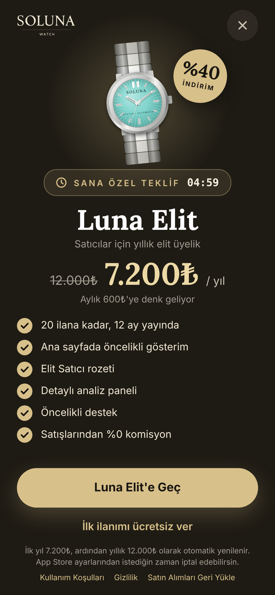
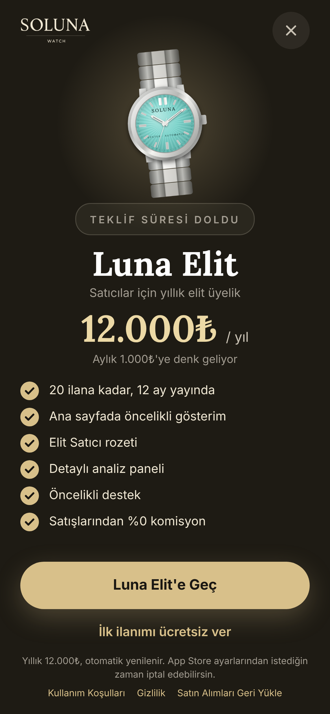

# SOLUNA – Luna Elit açılış paywall'u

Uygulama ilk açıldığında gösterilen, **5 dakika geçerli %40 indirimli** Luna Elit teklif ekranı.
React Native + RevenueCat. Yalnızca iOS için hazırlandı (Android'de de çalışır, mağaza kurulumu ayrıca yapılmalı).

## Tasarım

| Teklif aktif | Süre dolunca |
|---|---|
|  |  |

- Görseller iPhone @3x (1170×2532). Ölçü, renk ve font için **kaynak koddur**: `theme.ts` ve `LunaElitPaywall.tsx`.
- Canlı önizleme: repoyu indirip `docs/paywall-preview.html`'i tarayıcıda açın (sayaç çalışır). `?expired=1` süre dolmuş hali, `?s=10` sayacı 10 saniyeden başlatır.

| | Teklif aktif | Süre dolunca |
|---|---|---|
| Fiyat | ~~12.000₺~~ **7.200₺ / yıl** (ilk yıl) | **12.000₺ / yıl** |
| Aylık karşılığı | 600₺ | 1.000₺ |
| Rozet / sayaç | %40 İNDİRİM + 05:00 geri sayım | "Teklif süresi doldu" |

Luna Elit içeriği: 20 ilana kadar (12 ay yayında), ana sayfada öncelikli gösterim, Elit Satıcı rozeti, detaylı analiz paneli, öncelikli destek, %0 komisyon.

---

## Dosyalar

```
src/paywall/
  LunaElitPaywall.tsx      # Ekran
  useLimitedOffer.ts       # 5 dk sayaç (kalıcı) + "açılışta gösterildi mi" kontrolü
  useLunaElitPackages.ts   # RevenueCat: paketler, satın alma, geri yükleme
  config.ts                # Ürün/offering kimlikleri, linkler, özellik listesi
  theme.ts                 # Renkler ve fontlar
  assets/                  # logo.png, watch.png
```

## Kurulum

Gerekli paketler (projede yoksa):

```bash
npm i react-native-purchases react-native-svg @react-native-async-storage/async-storage
cd ios && pod install
```

`src/paywall` klasörünü projeye kopyalayın (ör. `src/features/paywall`).

### Fontlar

`theme.ts` içinde `Lora-Bold`, `Inter-Regular`, `Inter-SemiBold`, `Inter-Bold` kullanılıyor (uygulamanın onboarding ekranlarıyla aynı aile). Projede farklı isimlerle yüklüyse sadece `theme.ts`'deki isimleri değiştirin.

## Uygulamaya bağlama

RevenueCat zaten `Purchases.configure(...)` ile başlatılmış olmalı. Açılışta:

```tsx
import { LunaElitPaywall, shouldShowLaunchPaywall } from './features/paywall';

function Root() {
  const [showPaywall, setShowPaywall] = useState(false);

  useEffect(() => {
    shouldShowLaunchPaywall().then(setShowPaywall);
  }, []);

  if (showPaywall) {
    return (
      <LunaElitPaywall
        onClose={() => setShowPaywall(false)}
        onFreeListing={() => { setShowPaywall(false); navigation.navigate('IlanVer'); }}
        onPurchased={() => { setShowPaywall(false); /* elit özellikleri aç */ }}
      />
    );
  }
  return <App />;
}
```

> Öneri: Paywall'u herkese değil, onboarding'de **"Satmak istiyorum"** diyen kullanıcılara göstermek dönüşümü artırır; alıcıların aboneliğe ihtiyacı yok.

## Mağaza kurulumu (önemli)

İndirim **sadece teklif süresi içinde** alınabilmeli. Bunun için aynı abonelik grubunda **iki ürün** gerekiyor:

**App Store Connect → Abonelikler → (grup: Luna Elit)**

| Ürün ID (örnek) | Süre | Fiyat | Introductory offer |
|---|---|---|---|
| `soluna_luna_elit_yearly_launch` | 1 yıl | 12.000₺ | **Pay up front, 1 yıl, 7.200₺** |
| `soluna_luna_elit_yearly` | 1 yıl | 12.000₺ | Yok |

Tek ürüne intro offer koyarsanız indirim, sayaç bittikten sonra da uygulanır. İki ürün bunu engeller.

**RevenueCat**

- Entitlement: `luna_elit` (iki ürün de bağlı)
- Offering `luna_elit_launch` → **Annual** paketi = `soluna_luna_elit_yearly_launch`
- Offering `default` → **Annual** paketi = `soluna_luna_elit_yearly`

Kimlikleri farklı verirseniz `config.ts`'yi güncelleyin. **Fiyatlar koda yazılmadı**; mağazadan gelir, App Store Connect'te fiyat değişince ekran kendiliğinden güncellenir.

## Teklif kuralları (Apple + tüketici mevzuatı)

- Sayaç cihazda saklanır: uygulama kapatılıp açılsa da **kaldığı yerden devam eder, bittikten sonra bir daha başlamaz.** Her açılışta sıfırlanan sayaç yanıltıcı uygulama sayılır.
- Uygulama silinip yeniden kurulursa sayaç sıfırlanır. Bunu da engellemek için başlangıç zamanını kullanıcı hesabına bağlı olarak sunucuda tutun (`useLimitedOffer.ts` içindeki AsyncStorage okumasını API çağrısıyla değiştirmeniz yeterli).
- Kapat (X) ve "İlk ilanımı ücretsiz ver" her zaman görünür.
- Yenileme fiyatı ekranda açıkça yazılı; Kullanım Koşulları, Gizlilik ve Satın Alımları Geri Yükle linkleri mevcut. `config.ts`'deki link adreslerini kontrol edin.

## Test

- Sandbox hesabıyla satın alma ve geri yüklemeyi deneyin.
- Sayacı baştan görmek için AsyncStorage'dan `soluna.lunaElit.offerStartedAt` ve `soluna.lunaElit.launchPaywallSeen` anahtarlarını silin.
- Süre dolma ekranını hızlı görmek için `config.ts`'de `offerDurationSeconds` değerini geçici olarak 10 yapın.
